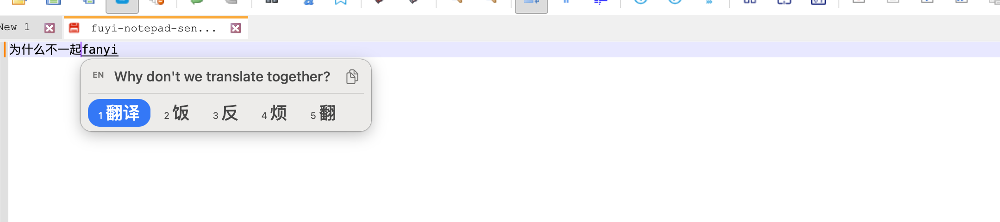

# 浮译 · Mac 本地试用版

安卓手机版本位于 [Android/](Android/README.md)，提供原生键盘、整句英文预览和保留 24 小时的本地加密剪贴板历史。安卓端使用独立的翻译 SDK，网络与隐私边界请以安卓文档为准。

输入中文拼音时，在候选词旁显示英文句子；可选默认输出中文或英文译文。当前版本为 **0.5.11 本地试用版**。

[下载安装包](https://github.com/tqq0531/FloatingTranslate/releases) · [隐私与密码输入说明](docs/PRIVACY.md) · [兼容性与验收记录](docs/COMPATIBILITY.md)



0.5.11 修复 Notepad-- 中文上屏后无效光标范围导致整句上下文被清空的问题，分段选词继续累积翻译；无效范围下禁止替换已确认的文字。

0.5.10 修复翻译候选浮窗圆角外侧的白色直角：窗口底层保持透明，毛玻璃材质使用圆角遮罩。已检查浅色、深色和浮窗尺寸变化时的四角透明度。

0.5.9 统一系统输入服务连接名，避免多份应用抢占连接；安装检查识别新版 macOS 的第三方输入法清单。新增“启用并试用”窗口，通过正常文本输入上下文启用浮译。本机已在不注销、不重启电脑或 Chrome 的情况下恢复菜单切换、中文输入、整句翻译、Shift 中英切换和鼠标选中复制。详见 [兼容性与验收记录](docs/COMPATIBILITY.md)。

0.5.8 增加系统设置已添加浮译、切换菜单却不显示时的登记修复与诊断。“安装 / 修复”会核实独立中文模式和菜单持久登记；缺失时先备份、仅补齐浮译两项，再刷新输入法菜单。部分已有登录会话仍需要保存文稿后注销并重新登录；登记通过不代表当前菜单已验证可用。

0.5.7 新增蓝色中英对话卡片 App 图标，包含 Retina 和小尺寸版本。设计原图及提示词见 [图标设计说明](docs/APPICON.md)。

0.5.6 将菜单栏、输入法列表和切换提示统一为居中的圆角“译”字牌，使用矢量图标及独立输入模式配置。升级后若仍显示旧图标，保存工作后注销并重新登录可刷新系统缓存。

0.5.5 修复选择浮窗英文时再次激活输入法、导致译文清空的问题。只读译文不创建输入会话，鼠标选择获得独立文本焦点。

0.5.4 提前初始化 IMK 服务，明确初始化并缓存系统文本客户端；补上按键事件中客户端为空时的兜底。更新输入法后，已经运行的浏览器可能需要保存草稿并正常重启，以重建旧输入连接。

0.5.3 减少 Chrome 的同步光标 / 文本范围查询，浮窗定位延后并复用可靠坐标；英文支持鼠标拖选、右键复制、Command+C 和右侧按钮复制整句。

0.5.2 修正菜单栏图标的 TIFF 主帧尺寸，并更换资源名称以避开旧图标缓存；不改动输入行为。

0.5.1 改进输入会话的激活、切走清理、快捷键放行与编辑文本更新；引擎不可用时放行原始按键。已参考鼠须管和小麦注音的实现，详见 [兼容性与参考实现](docs/COMPATIBILITY.md)。真实 Chrome 使用仍需人工验证。

0.5.0 增加当前句子的分段合并：例如依次输入并确认“我”“今天”“去北京”，英文会随整句更新。拼音改用随包内置的本地 Rime 引擎，支持全拼、首字母简拼、部分常见拼音错拼与整句组词。用户词库学习关闭。

单独轻按 Shift 切换中文 / English 直接输入；Shift 加字母不切换。英文和中文候选显示在同一个浮窗。

> **隐私重点：正文使用 Apple 本机翻译，不发送到开发者或第三方翻译服务；语言包首次准备需要联网。浮译不保存输入历史。密码输入请切换系统 ABC，不要在试用框输入密码。不能承诺所有自定义密码框都能被识别。** 详见 [隐私与密码输入说明](docs/PRIVACY.md)。

## 系统要求

- macOS 26 或更新版本。
- 当前在 Apple Silicon Mac 上验证。Intel 兼容情况以随包说明与实际测试为准。
- 中英翻译语言包；首次下载需联网，之后使用本机模型。
- 使用安装包不需要 Xcode、Swift、Homebrew、API Key 或开发者账户。

这是试用版本，使用本地 Rime 引擎和固定词库，不是苹果的拼音引擎。支持简拼和常见错拼规则，但没有个人词频学习、英文语法检查或云词库；不能保证候选排序与苹果一致。

## 安装：推荐从应用窗口操作

1. 完整解压安装包，打开 **浮译.app**，点击 **安装 / 修复输入法**。
2. 安装完成会打开 **启用浮译** 窗口；也可在浮译设置中点击 **启用并试用**。在白色输入框输入 `nihao`，按空格，应出现“你好”和英文翻译。
3. 在屏幕右上角的输入法菜单选择 **浮译**，到其他软件继续输入。单独轻按 Shift 切换中文 / English。
4. 如果启用窗口提示系统尚未识别，请在 **系统设置 → 键盘 → 文字输入 → 编辑 → ＋** 中搜索并添加“浮译”，点击 **完成**，然后重新点 **启用并试用**。

安装会校验签名、备份已有应用并复制到 `~/Library/Input Methods/浮译.app`。旧应用备份保存在 `~/Library/Application Support/FloatingTranslate/Backups/`，以 `浮译.app.backup` 保存，恢复时可复制并改名为 `浮译.app`。菜单登记备份仅包含输入法标识与配置，不含输入文字。安装程序不自动注销或关闭浏览器。

本机 0.5.9 已验证无需注销即可恢复；这不保证每台新机器、每种输入控件都无需额外的系统添加步骤。暂未签名公证为公开发行版本，仍为本地试用包。

## 使用方法

| 操作 | 行为 |
| --- | --- |
| 单独轻按 Shift | 切换中文拼音 / English 直接输入；中途切换会保留当前输入的原始拼音 |
| Shift + 字母 | 正常输入大写，不切换输入模式 |
| English 直接输入 | 字母、标点、空格和快捷键直接交给目标应用，不触发拼音或翻译 |
| 全拼 / 简拼 | 如 `nihao` / `nh` 得到“你好”，`nhm` 得到“你好吗”；缩写有歧义，可用数字选词 |
| 常见错拼 | 如 `zhogn` 可得到“中”，`nihoa` 可得到“你好”；任意漏字或乱序不保证纠正 |
| 分段确认中文 | 连续选词上屏后，英文根据当前整句更新，不再只翻译最后几个字 |
| 空格 / 数字键 / 点击候选 | 中文默认时确认中文；存在未选拼音时继续选词 |
| 默认输出英文 | 先选词形成中文，再按空格或回车输入就绪的英文译文 |
| 回车 | 输入设置中的默认语言；无中文候选时可保留原始拼音 |
| Tab | 有正在编辑的拼音时输入另一种语言；英文译文需要就绪，替换整句要求应用能报告准确的文本范围 |
| 方向键 / 翻页 | 切换候选和翻页，数字键 1–5 选择当前页候选 |
| 退格 | 删除当前拼音或已选汉字 |
| Esc | 取消当前组合 |
| `xi'an` | 保留音节边界，区分“西安”和“先” |
| 鼠标拖选英文 | 右键“复制选中英文”或 Command+C；右侧复制按钮 / 右键菜单可复制整句 |
| 隐私模式 | 直接输入英文字符，暂停拼音和翻译 |

Chrome 中为避免浏览器等待网页渲染而停顿，不读取文档选区；整句范围替换不可用时请复制英文。坐标在同一组合内复用，并在逐词确认后限频更新；输入框切换和结束组合时清理上下文。

英文和中文候选共用一个窗口，使用 InputMethodKit 的文本位置接口定位；翻译中、拼音未完成或语言包不可用时显示状态。不会读取文档正文，也不跳到鼠标位置。

简拼可能对应多个词，例如 `zg` 同时可能是“这个”“中国”等，请选择候选。无候选的原始字母不会混入中文翻译；简拼可以形成候选，所以随机字母也可能被解释成中文。打英文请轻按 Shift 切换 English。

当前句子只累计本次通过浮译输入的内容，不读取之前的段落。句号、问号、感叹号结束一句；回车、Esc、光标移动、选区替换、鼠标点击、切换应用 / 输入法或快捷键操作会结束或清理当前上下文。未完句停顿超过 60 秒清理；句末译文最多保留 8 秒。有些应用不会报告准确的文本位置，这些情况下可能提前清理上下文。

“English 直接输入”用于正常打英文，不经过翻译；“中文模式的默认输出”决定拼音转换后最终输入中文还是英文译文，二者是独立选项。当前翻译方向固定为中文 → 英文。切换应用、输入法或使用 Command / Control / Option 快捷键时，未提交内容通常按中文原文保留；安全输入 / 隐私模式生效时停止处理并清空活动内容。空格确认中文后保留当前句子以继续翻译，不读取历史段落；安全输入会清理这段内存中的上下文。

## 更新与排障

- 更新前先通过系统菜单手动切换到 ABC，再退出菜单栏“浮译”，随后打开新版应用安装 / 修复，最后通过系统菜单手动重新选择浮译。已运行的旧进程不会凭复制文件自动变成新版本。
- Chrome 无法打字：先点回 Chrome，再从右上角系统输入法菜单手动选 ABC。macOS 26 的程序化输入法切换可能遗漏激活 / 结束会话，程序报告切换成功不等于目标软件已恢复。不要反复用脚本切换。若更新输入法后仍然无法输入、而新启动的 Chrome 能输入，请保存网页草稿后正常退出并重新打开 Chrome，重建旧输入连接。
- 切换菜单没有浮译：先点浮译设置中的 **启用并试用**，在新窗口输入 `nihao` + 空格验证。仍未识别时点 **安装 / 修复输入法**，然后在系统设置重新添加并点“完成”，再次打开启用窗口。不要只凭“已注册”提示判断能否使用。
- 显示“本机翻译未就绪”：到设置检查语言包。没有在线翻译备用接口。
- 出现候选栏但没有英文：先补全拼音；检查语言包、隐私模式和目标应用是否开启安全输入。
- 个别网页或应用不报告正确的光标位置：可能隐藏英文条。请在备忘录用虚构句子对比；兼容性仍需继续验证。
- 缩写联想不符合预期：检查是否处于中文模式，查看其他候选；本版为固定词库和规则，不会学习个人用词。

## 隐私与密码

- 无开发者服务器、用户账户、广告统计、全局按键监听或剪贴板读取。
- 不保存输入 / 译文历史，不建立用户词频库；只保存默认语言、位置、隐私开关等设置。
- 翻译使用已安装的 Apple 本机模型。准备语言包需联网；Apple 可能收集不包含正文的使用与性能指标。
- 检测到 macOS Secure Input 时停止处理，并取消翻译、清空浮窗。
- **建议密码、验证码、密钥等切换系统 ABC 输入。第三方应用若没有正确启用密码框保护，浮译无法保证识别。**

完整的数据生命周期、密码框边界、网络说明与验证方法见 [docs/PRIVACY.md](docs/PRIVACY.md)。

## 构建与测试

开发构建需要 macOS 26 SDK、Swift 6.2、Xcode Command Line Tools，以及 Homebrew 的 `librime`（本版用 1.17.0 验证）。先运行 `brew install librime`；这一步需要联网下载开发依赖。构建脚本将 Rime 与其动态库依赖复制进应用，最终用户无需 Homebrew。词库和已编译方案随源码提供，输入时无需下载。

```sh
./scripts/build.sh
./scripts/test.sh
./scripts/test-panel.sh
./scripts/test-controller.sh
./scripts/package.sh
```

测试覆盖：全拼词组、首字母简拼、常见错拼、候选消耗的原始按键数、分段句子合并与清理、安全替换范围、音节分隔、屏幕边缘和副屏定位、真实 Secure Input 与隐私模式拦截、浮窗清理、源代码隐私检查及签名校验。语言包可用时执行真实翻译；没有语言包时明确跳过。

`test-panel.sh` 使用真实本机翻译结果，检查英文和候选确实在同一可见窗口中绘制，并输出 `build/panel-preview.png`。

`test-controller.sh` 用模拟 IMK 文本客户端执行真实输入会话逻辑，验证逐词上屏、整句翻译、Command+L 放行、重复结束会话、不提供文本范围的应用、引擎缺失与隐私边界。它不会模拟全局按键，也不能代替 Chrome 实际验收。

新增检查覆盖 Chrome 按键处理期间不查询范围 / 坐标、坐标查询限频、失效回调取消，以及选中 / 整句英文复制和隐私拦截。

这些测试不等于覆盖所有第三方应用。浮窗跟随和鼠标选择还需在实际使用的软件中验证。自动生成的 NSEvent 在本机未触发系统输入法，不能作为端到端通过证据；可运行 `./scripts/manual-input-check.sh` 打开只用于虚构文字的手动验收窗口。

## 卸载

1. 切换到系统 ABC；在键盘设置移除浮译。
2. 退出菜单栏“浮译”，删除 `~/Library/Input Methods/浮译.app`。
3. 可选删除 `~/Library/Application Support/FloatingTranslate/Backups/` 的旧应用备份。
4. 可选运行 `defaults delete com.fuyi.inputmethod.FloatingTranslate` 删除设置。Apple 语言包由系统管理。

## 词库与许可证

本地拼音引擎为 [Rime / librime](https://github.com/rime/librime)（BSD 3-Clause）。拼音词库与方案规则基于 [rime/rime-pinyin-simp](https://github.com/rime/rime-pinyin-simp)，词库源于 Android 开源项目，许可见 `Resources/RIME-LICENSE.txt`（Apache 2.0）。Rime 及其随包依赖的许可证位于应用内 `Contents/Resources/ThirdPartyLicenses/`。未接入苹果私有输入引擎。

0.5.5 已在本机 Chrome 完成真实键鼠验收：分段中文输入、整句英文显示、整句复制、拖选后 Command+C 并粘贴均通过。详见 docs/COMPATIBILITY.md。
